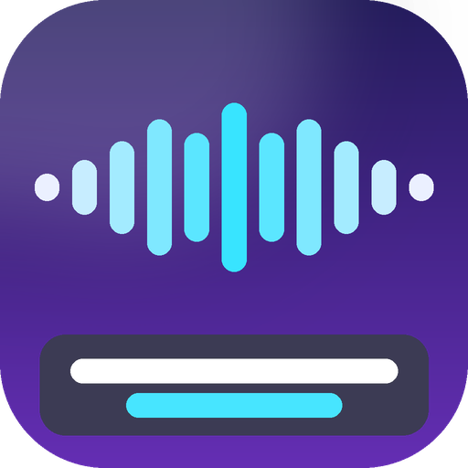
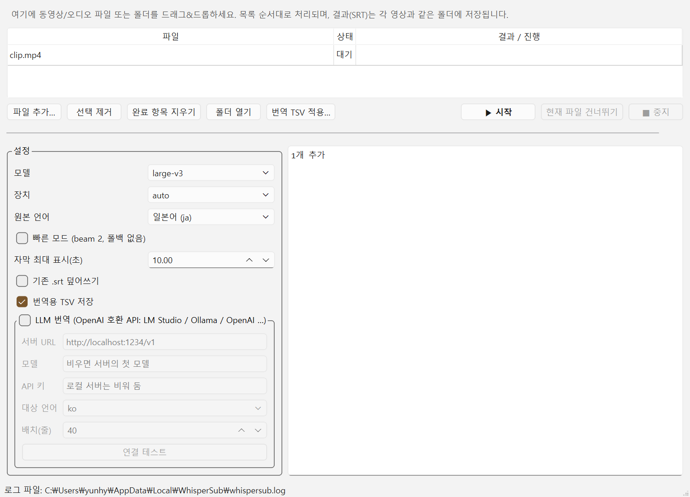

<p align="center"></p>

# WhisperSub

**영상을 드래그&드롭하면 자막(SRT)이 영상 폴더에 생성되는 Windows 앱.**
Whisper(large-v3)로 음성을 인식하고, 의미 없는 감탄사·의성어·환각(hallucination) 줄을 자동으로 걸러내며,
원하면 LLM(LM Studio / Ollama / OpenAI 호환 API)으로 번역 자막까지 만듭니다.

> Drag & drop media files → queued, sequential Whisper transcription → `.srt` next to each video.
> Optional translation through any OpenAI-compatible chat API. GPU (CUDA) is used automatically when available.



## 주요 기능

- **여러 파일/폴더 드래그&드롭** → 대기열에 쌓이고 순서대로 처리 (모델은 한 번만 로드)
- 결과는 **영상과 같은 폴더**에 저장
  - `영상.ja.srt` — 인식 원문 자막 (기존 파일이 있으면 `영상.ja.whisper.srt`로 보존 저장)
  - `영상.translate.tsv` — 번역용 표 (id / 시각 / 원문 / 빈 번역 열)
  - `영상.ko.srt` — LLM 번역 자막 (번역 켠 경우), `영상.ko.tsv` — 번역 결과(수정 후 재적용 가능)
  - `영상.whisper.json` — 필터된 세그먼트(번역 TSV 적용에 사용)
- **자동 필터**: 감탄사·의성어·웃음, 단독 필러(うん/はい/ねえ…), 반복 환각 루프, 가짜 화자명 접두어, "ご視聴ありがとうございました"류 환각 제거, 연속 동일 대사 병합, 자막 1줄 최대 표시 시간 제한
- **GPU 자동 사용**: NVIDIA GPU + 드라이버만 있으면 CUDA(fp16), 없으면 CPU(int8)로 자동 폴백 — CUDA Toolkit 별도 설치 불필요
- **빠른 모드**: 대사가 적고 잡음이 긴 영상용 (beam 2, temperature 폴백 없음)
- **번역**: OpenAI 호환 `/v1/chat/completions` — LM Studio(기본 `http://localhost:1234/v1`), Ollama(`http://localhost:11434/v1`), OpenAI 등. 배치 번역 + 앞 문맥 전달
- **번역 TSV 적용**: 외부에서 번역한 TSV(마지막 열 = 번역, `-` = 삭제)로 자막 생성
- 설정·대기열은 종료 시 저장되어 다음 실행 때 복원
- 콘솔용 `whispersub-cli.exe` 동봉 (배치 스크립트/자동화용)

## 설치

[Releases](https://github.com/yunhyok/WhisperSub/releases)에서 `WhisperSub-Setup-x.y.z.exe`를 받아 실행하세요.
관리자 권한 없이 사용자 폴더(`%LOCALAPPDATA%\Programs\WhisperSub`)에 설치됩니다.

- Windows 10/11 64-bit
- GPU 가속: NVIDIA GPU + 최신 드라이버 (CUDA 12 호환). 없으면 CPU로 동작(느림)
- 첫 실행 시 선택한 모델을 Hugging Face에서 내려받습니다 (large-v3 약 3 GB, `%USERPROFILE%\.cache\huggingface`)

## 사용법

1. WhisperSub 실행 → 영상 파일(들)을 창에 드롭 (또는 **파일 추가…**)
2. 설정 확인: 모델(`large-v3` 권장), 원본 언어, 필요 시 **빠른 모드**
3. **▶ 시작** — 진행률과 로그가 표시되고, 끝난 항목을 더블클릭하면 폴더가 열립니다
4. 번역이 필요하면 **LLM 번역** 그룹을 켜고 서버 URL/모델을 입력 → **연결 테스트** 후 시작.
   또는 `영상.translate.tsv`의 마지막 열을 채운 뒤 **번역 TSV 적용…**

### CLI

```
whispersub-cli.exe "D:\video\a.mp4" "D:\video\b.mkv" --lang ja --fast
whispersub-cli.exe a.mp4 --translate --llm-url http://localhost:1234/v1 --target ko
whispersub-cli.exe a.mp4 --apply a.translate.tsv          # 번역 TSV 적용만
whispersub-cli.exe a.mp4 --start 300 --end 420            # 구간 테스트
```

## 소스에서 빌드

```
git clone https://github.com/yunhyok/WhisperSub.git
cd WhisperSub
build.cmd        # .venv 생성 → 의존성 설치 → 아이콘 생성 → PyInstaller → Inno Setup
```
결과: `dist\WhisperSub\WhisperSub.exe`, `dist\WhisperSub-Setup-<버전>.exe`
(python.org CPython 3.11/3.12 x64 — conda Python은 Qt 6.12와 MSVC 런타임 충돌로 불가 — 및 [Inno Setup 6](https://jrsoftware.org/isinfo.php) 필요)

개발 모드 실행: `python -m whispersub` (GUI) / `python -m whispersub --cli FILE`

## 동작 원리

```
media ─PyAV(FFmpeg)─► 16 kHz mono ─Silero VAD + faster-whisper─► segments
      ─filter(노이즈/환각/반복 제거, 병합)─► .srt / .translate.tsv / .whisper.json
      ─(optional) OpenAI-compatible LLM─► .ko.srt
```

## 라이선스

MIT — 자세한 내용은 [LICENSE](LICENSE), 동봉 구성요소는 [THIRD_PARTY_NOTICES.md](THIRD_PARTY_NOTICES.md) 참고.
Whisper 모델 가중치는 번들되지 않으며 첫 실행 시 사용자가 Hugging Face에서 내려받습니다.
